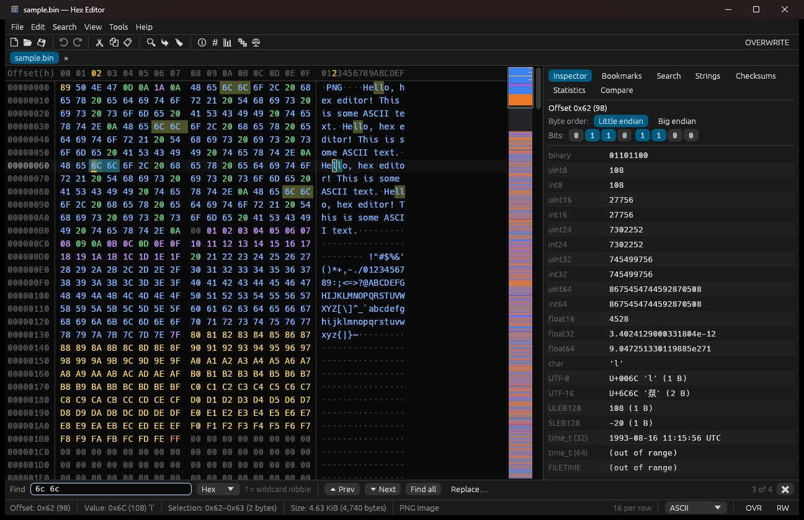

# Hex Editor

A fast, feature-rich, cross-platform hex editor written in Rust with [egui](https://github.com/emilk/egui).
It runs natively on Windows, macOS and Linux.



## Features

**Editing**
- Insert and overwrite modes (`Insert` toggles); type in the hex column (nibble by nibble) or in the text column
- Unlimited undo/redo, with consecutive typing merged into one step
- Cut, copy and paste, with automatic hex/text detection on paste
- Paste special: hex string, raw text, Base64
- Copy as: hex, text, C / Rust / Python / C# / Java / Go / JavaScript arrays, Base64, hex dump
- Fill a selection with a hex pattern, text or random bytes; insert N bytes anywhere
- Transform a selection: XOR/AND/OR/ADD/SUB with a multi-byte key, NOT, negate, shifts, rotates,
  bit reversal, byte-order swaps (16/32/64-bit), random fill, increasing sequence
- Insert a file at the cursor, save a selection to a file
- Per-file read-only mode (files without write permission open read-only)
- Modified bytes are highlighted until the file is saved

**Navigation & search**
- Virtualized rendering keeps scrolling smooth even for very large files (files are loaded into memory)
- Go to an absolute or relative offset (hex or decimal), select a range by end or length
- Find hex patterns with nibble wildcards (`4D 5A ?? ?0`), text (UTF-8 / UTF-16 LE/BE,
  case-insensitive) or numeric values (8–64-bit integers and floats, either endianness)
- Live highlighting of all matches while typing, with a match counter
- Find next/previous with wrap-around, find all (results list), replace and replace all
- Other occurrences of the current selection are highlighted automatically
- Named, colored bookmarks with next/previous navigation
- Minimap of the whole file (byte classes or entropy) with search and bookmark markers

**Analysis**
- Data inspector: binary, 8/16/24/32/64-bit signed and unsigned integers, half/single/double floats,
  ASCII / UTF-8 / UTF-16 characters, ULEB128/SLEB128, Unix time (32/64-bit), Windows FILETIME,
  DOS date/time and GUID, in little or big endian. Double-click a value to edit it, click bits to toggle them.
- Checksums & hashes: CRC-16/CCITT, CRC-32, Adler-32, MD5, SHA-1, SHA-256, SHA-512, Sum-8/16/32, XOR-8
- Statistics: Shannon entropy, byte histogram (linear/log), character class breakdown, most common bytes
- String extraction (ASCII and UTF-16LE) with filtering
- Byte-by-byte comparison of two open files with difference highlighting and navigation
- File-type detection from magic numbers (PNG, ZIP, ELF, PE, Mach-O, PDF, SQLite, …)

**Interface**
- Multiple files in tabs, drag & drop to open, recent files
- Dark, light or system theme; adjustable font size and UI scale
- Configurable bytes per row (or fit to window), byte grouping, offset base (hex/dec/octal),
  uppercase/lowercase hex
- Text column in ASCII, Windows-1252, CP437 (DOS) or EBCDIC
- Color-coded bytes by class (zero, printable, whitespace, control, high)
- Unsaved-changes protection and detection of files changed on disk
- Settings are remembered between sessions

## Keyboard shortcuts

| Keys | Action |
| --- | --- |
| `Ctrl+N` / `Ctrl+O` / `Ctrl+S` / `Ctrl+Shift+S` | New / open / save / save as |
| `Ctrl+W` / `Ctrl+Tab` | Close tab / next tab |
| `Ctrl+Z` / `Ctrl+Y` | Undo / redo |
| `Ctrl+X` / `Ctrl+C` / `Ctrl+V` | Cut / copy / paste |
| `Insert` | Toggle insert / overwrite |
| `Tab` | Switch between hex and text column |
| `Ctrl+F` / `Ctrl+H` / `F3` / `Shift+F3` | Find / replace / next / previous |
| `Ctrl+G` / `Ctrl+Shift+G` | Go to offset / select range |
| `Ctrl+B` / `F2` / `Shift+F2` | Toggle bookmark / next / previous |
| `Ctrl+E` / `Ctrl+I` / `Ctrl+T` | Fill / insert bytes / transform |
| `F7` / `Shift+F7` | Next / previous difference |
| `Ctrl+Plus` / `Ctrl+Minus` / `Ctrl+Wheel` | Font size |
| `F1` | All shortcuts |

On macOS, use `Cmd` instead of `Ctrl`.

## Installing

Download the latest build for your platform from the
[Releases](../../releases) page:

| Platform | Package |
| --- | --- |
| Windows x64 / ARM64 | `.zip` with a portable `hexeditor.exe` |
| macOS (universal) | `.dmg` or `.zip` with `Hex Editor.app` |
| Linux x64 / ARM64 | `.tar.gz` or `.deb` |

The macOS app is ad-hoc signed but not notarized. On first launch, right-click the app and
choose **Open**, or run `xattr -dr com.apple.quarantine "/Applications/Hex Editor.app"`.

## Building from source

Requires Rust 1.95 or newer.

```sh
cargo run --release -- path/to/file.bin
```

Files passed on the command line are opened in tabs. No extra system packages are needed on
Linux; the app loads X11/Wayland libraries at runtime.

Run the checks that CI runs:

```sh
cargo fmt --all --check
cargo clippy --all-targets -- -D warnings
cargo test
```

## Releasing

1. Bump `version` in `Cargo.toml` and commit.
2. Tag the commit and push the tag:
   ```sh
   git tag v0.2.0
   git push origin v0.2.0
   ```
3. The [Release workflow](.github/workflows/release.yml) builds Windows (x64, ARM64),
   macOS (universal `.app` in `.dmg`/`.zip`) and Linux (x64, ARM64 `.tar.gz` and `.deb`),
   then publishes a GitHub release with the artifacts and `SHA256SUMS.txt`.
   Tags with a suffix such as `v0.2.0-beta.1` are published as pre-releases.

Running the Release workflow manually (*Actions → Release → Run workflow*) builds all
artifacts without publishing a release.

## Project layout

| Path | Purpose |
| --- | --- |
| `src/app.rs` | Application shell: tabs, menus, toolbar, status bar, commands |
| `src/editor.rs` | The hex view widget: rendering, cursor, selection, keyboard/mouse editing, minimap |
| `src/document.rs` | File buffer with undo/redo, modification tracking, bookmarks, safe saving |
| `src/search.rs`, `src/find.rs` | Pattern matching and the find/replace bar |
| `src/inspector.rs` | Data inspector |
| `src/analysis.rs` | Hashes, statistics, strings, comparison, file type detection, background jobs |
| `src/panels.rs`, `src/dialogs.rs` | Side panels and dialogs |
| `scripts/gen_icons.py` | Regenerates the icons in `assets/` |

## License

[MIT](LICENSE)
